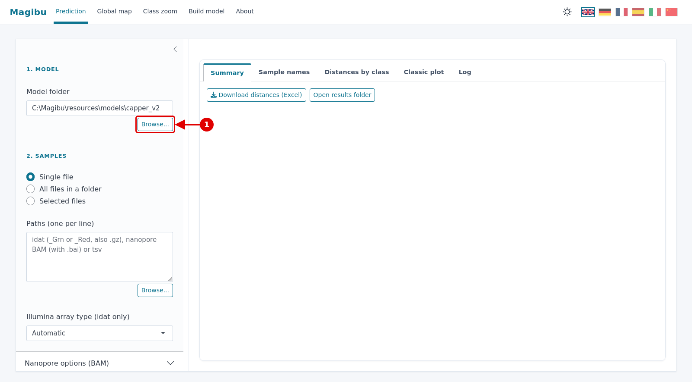
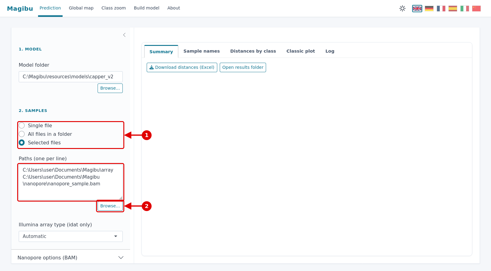
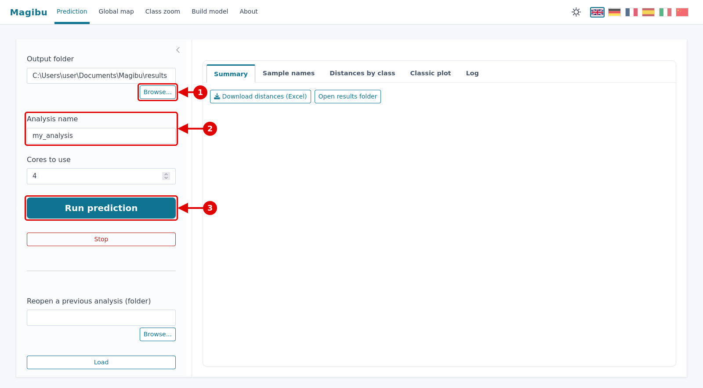
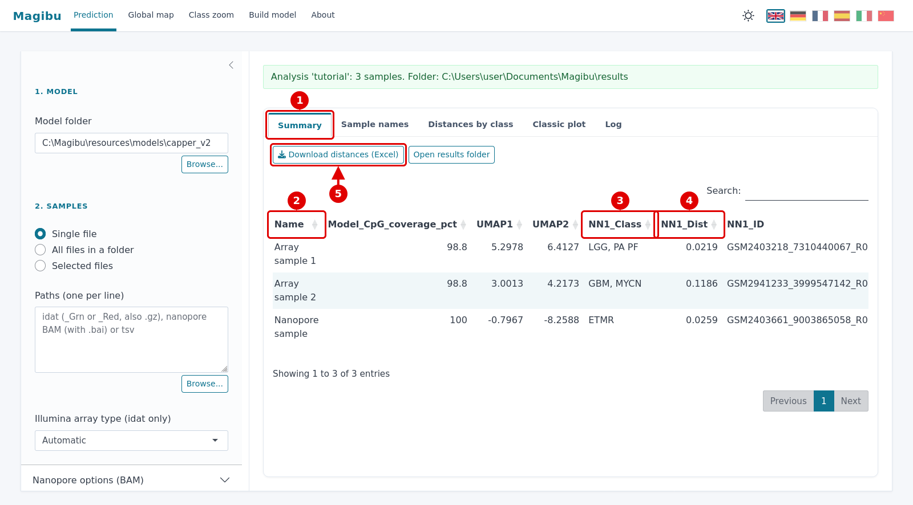
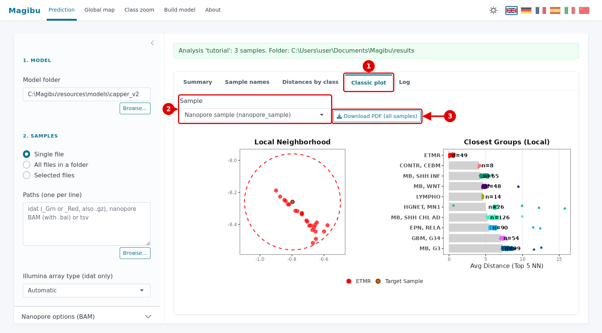
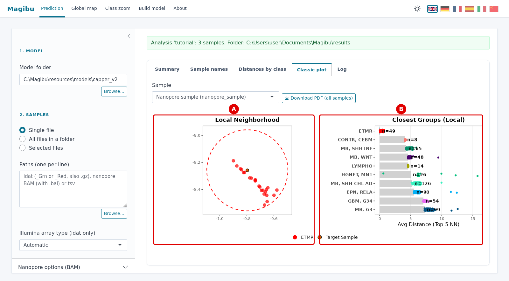
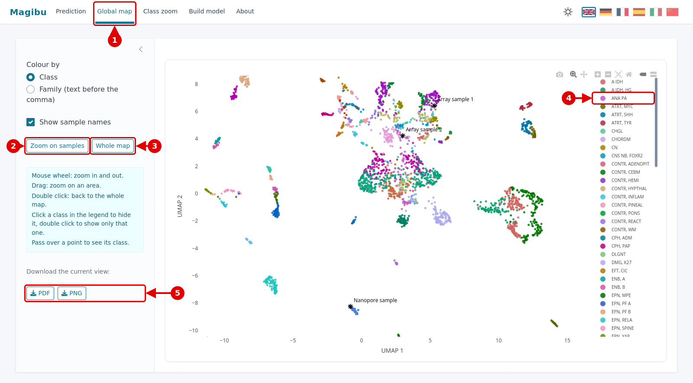

# Magibu App: express tutorial

Classify your samples in a few clicks. The red numbers in each picture match the numbered points below it.

| Step | What you do |
|:---:|---|
| **1** | [Select the model](#step-1--select-the-model) |
| **2** | [Select the files](#step-2--select-the-files) |
| **3** | [Name the analysis and start](#step-3--name-the-analysis-and-start) |
| **4** | [See the distances of all samples](#step-4--see-the-distances-of-all-samples) |
| **5** | [Classic plot: read it and download it](#step-5--classic-plot-read-it-and-download-it) |
| **6** | [Interactive global map](#step-6--interactive-global-map) |

For every option, see the [full tutorial](TUTORIAL.md). **Research use only.**

> **Download:** [Magibu for Windows (zip, 650 MB)](https://github.com/GianlucaMattei/MAGIBU/releases/download/v0.7.0-app/Magibu-0.7.0-win.zip).
> Unzip it in any folder and double click **Magibu.exe**. No installation needed.

---

## Step 1 · Select the model

**1.** Click **Browse...** under *Model folder* and select the folder of the model.

> **Tip:** the default model (CNS tumours, Capper et al. 2018) is already selected. If you use it, skip this step.

---

## Step 2 · Select the files

**1.** Choose what you want to select:
- **Single file**: one sample;
- **All files in a folder**: all the samples in a folder;
- **Selected files**: several files of your choice.

**2.** Click **Browse...** and select the files. They appear in the box above, one per line.

> **Which files?**
> - Illumina arrays: the `_Grn.idat` (or `_Red.idat`) file of each sample.
> - Nanopore: the `.bam` file, with its `.bai` file in the same folder.
>
> Arrays and nanopore files can be analysed together.

---

## Step 3 · Name the analysis and start

Scroll down the left panel.

**1.** Click **Browse...** under *Output folder* and choose where to save the results.

**2.** Type a name in **Analysis name** (for example `my_analysis`). The result files are named after it.

**3.** Click **Run prediction**.

> **Tip:** a blue bar shows that the analysis is running. When it turns green, the results are ready.

---

## Step 4 · See the distances of all samples

**1.** Click **Summary**: one row per sample, all samples together.

**2.** **Name**: the sample.

**3.** **NN1_Class**: the class closest to the sample. **This is the result.**

**4.** **NN1_Dist**: how close it is. **Smaller = more similar.**

**5.** **Download distances (Excel)**: saves the table.

> **Tip:** scroll the table to the right for more columns:
> - the 2nd and 3rd closest classes;
> - **Model_CpG_coverage_pct**: if it is below 50%, a yellow warning appears and the result is not reliable.

---

## Step 5 · Classic plot: read it and download it

**1.** Click **Classic plot**.

**2.** Choose the **Sample**.

**3.** **Download PDF (all samples)**: one PDF with the plots of all samples.

### How to read it

**A · Local Neighborhood.** Your sample is the orange dot with a black border (*Target Sample*). Around it are the closest reference
samples, coloured by class. If the nearby dots are all the same colour, the sample clearly belongs to that class.

**B · Closest Groups.** The closest classes, from top to bottom:
- **grey bar**: average distance from the 5 closest samples of the class. **Shorter bar = more similar**;
- **coloured dots**: the single samples of that class;
- **n**: how many samples the class has.

> **In this example:** the first class (ETMR) has a very short bar, the next ones are much longer. The result is
> clear. When the first two bars are similar, the sample lies between two classes.

---

## Step 6 · Interactive global map

**1.** Click **Global map** in the top bar. Your samples are the black stars with their names.

**2.** **Zoom on samples**: moves the view to your samples.

**3.** **Whole map**: back to the full map.

**4.** **Legend**: click a class to hide it, double click to show only that class (double click again to show all).

**5.** **PDF** / **PNG**: save what you see.

> **With the mouse on the map:**
> - wheel: zoom in and out;
> - drag: zoom on an area;
> - double click: back to the whole map;
> - pass over a point: see its class.
