# Magibu App tutorial

This guide shows where to click to:

1. [Classify samples](#1-classify-samples) (Illumina arrays and nanopore)
2. [Look at the results](#2-look-at-the-results): summary, distances by class, classic plot
3. [Explore the global map](#3-explore-the-global-map)
4. [Build your own model](#4-build-your-own-model)

The red numbers in the pictures match the numbered steps in the text.

**Research use only:** Magibu is not a diagnostic device.

## Start the app

Download `Magibu-<version>-win.zip` from the [Releases](https://github.com/GianlucaMattei/MAGIBU/releases) page,
unzip it in any folder and double click **Magibu.exe**. No installation is needed. The first start takes a few
seconds.

You can change the language with the flags at the top right, and switch between light and dark mode with the
sun/moon icon.

---

## 1. Classify samples

Click **Prediction** in the top bar (it is the page that opens at start).

### Choose the model and the samples

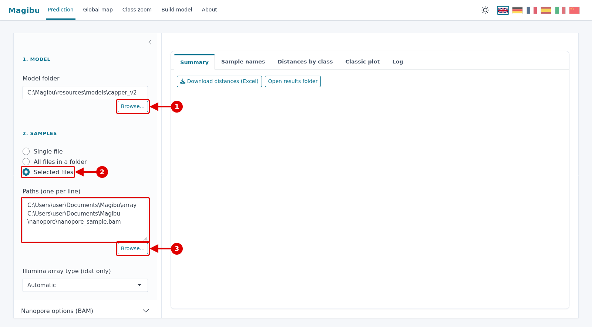

1. **Browse...** under *Model folder*: the reference model. The default one (CNS tumours, Capper et al. 2018) is
   already selected, so you can skip this step. Change it only to use a model you built yourself
   ([section 4](#4-build-your-own-model)).
2. Choose how to pick the samples:
   - *Single file*: one sample;
   - *All files in a folder*: every sample in a folder;
   - *Selected files*: several files.
3. **Browse...** under *Paths*: select the files or the folder. The chosen paths appear in the box above, one per
   line.

What you can select:
- **Illumina arrays** (EPIC v2, EPIC v1, 450k): select the `_Grn.idat` or the `_Red.idat` file of each sample. The
  two files of a sample must be in the same folder.
- **Nanopore**: the `.bam` file aligned to the hg38 genome, with methylation information (for example from dorado).
  Its index file (same name ending in `.bai`) must be in the same folder.
- Arrays and nanopore files can be analysed together.

Leave *Illumina array type* on **Automatic**.

### Nanopore options

Needed only for nanopore BAM files. You can leave the defaults.

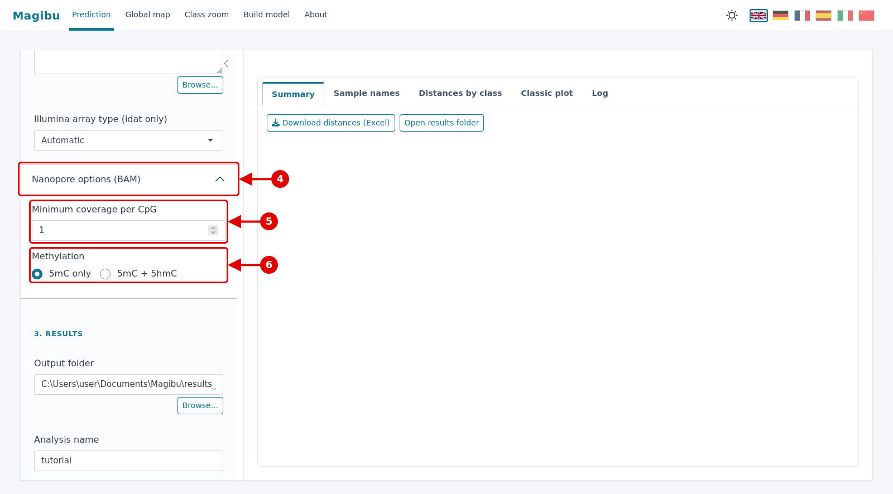

4. Click **Nanopore options (BAM)** to open the panel.
5. **Minimum coverage per CpG**: CpG sites read fewer times than this are ignored. Keep 1 for short runs.
6. **Methylation**:
   - **5mC only** (default): same as the original Magibu pipeline;
   - **5mC + 5hmC**: hydroxymethylation is counted as methylation.

### Choose where to save and start

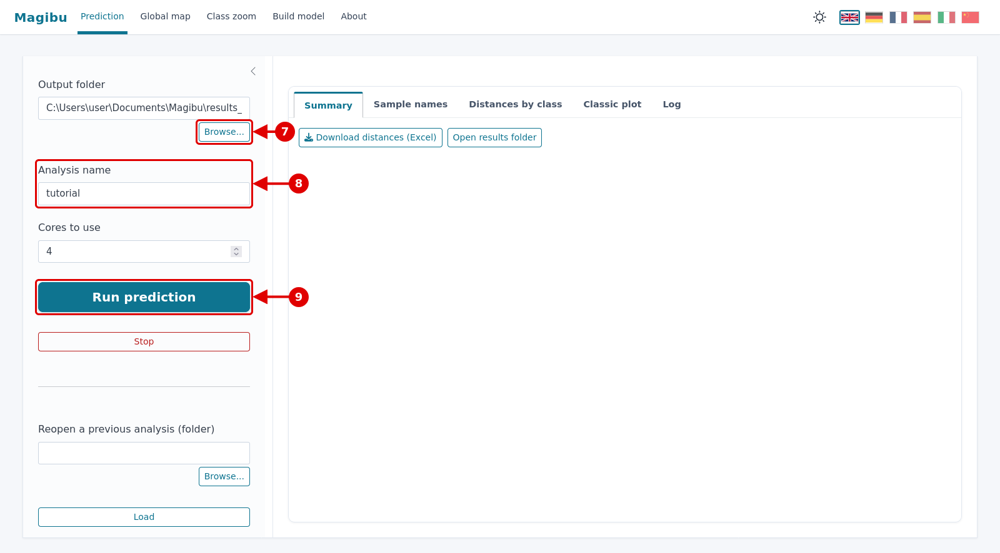

7. **Browse...** under *Output folder*: the folder where the results are saved.
8. **Analysis name**: used for the names of the result files.
9. Click **Run prediction**.

### While it runs

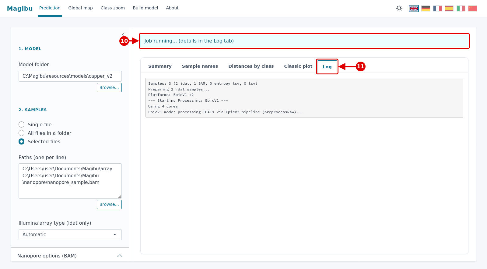

10. The blue bar says that the analysis is running.
11. Click **Log** to follow the progress. A whole-genome nanopore BAM takes a few minutes.

To cancel, click **Stop** (under *Run prediction*). When the analysis ends, the bar turns green and the results
appear.

### Reopen a previous analysis

Results are saved, so an analysis can be opened again later without running it again.

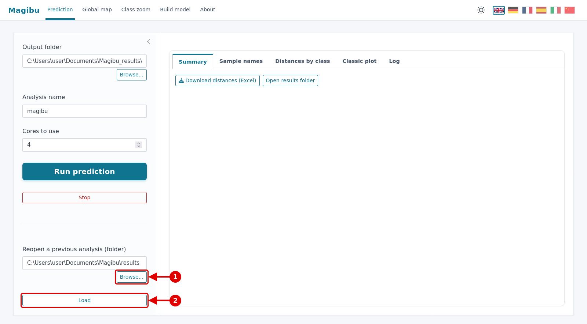

1. **Browse...** under *Reopen a previous analysis*: select the output folder of that analysis.
2. Click **Load**.

---

## 2. Look at the results

### Summary

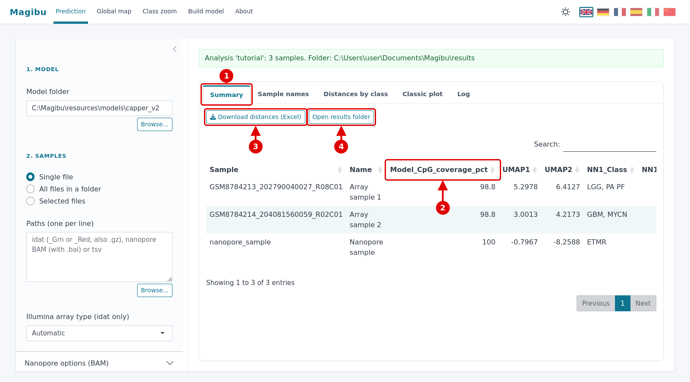

1. Click **Summary**: one row per sample.
2. **Model_CpG_coverage_pct**: the percentage of the CpG sites of the model that were measured in the sample.
   Arrays are usually close to 100%. For nanopore it depends on how long the sample was sequenced. **Below 50%, a
   yellow warning appears and the result is not reliable.**
3. **Download distances (Excel)**: saves all the tables in one Excel file.
4. **Open results folder**: opens the output folder.

Scroll the table to the right to see the classification:

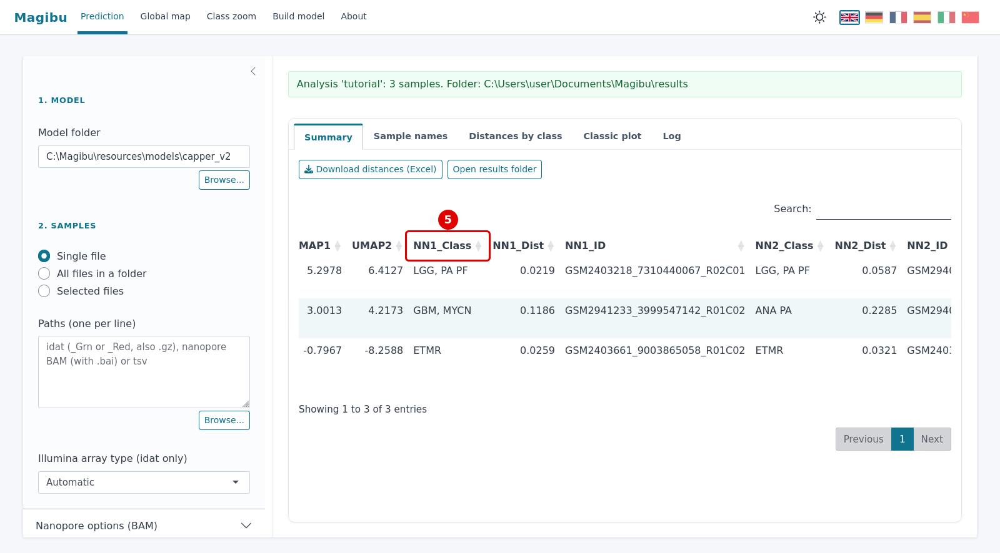

5. **NN1_Class**: the class of the reference sample closest to your sample.

   The other columns are read the same way:
   - **NN2** and **NN3**: the second and third closest reference samples;
   - **Group1..3**: the three closest classes;
   - **kNN5_Class**: the most common class among the 5 closest reference samples;
   - **kNN5_Purity**: the share of those 5 samples that belong to that class (1 = all of them).

   A sample is clearly placed when these columns agree and the distances (`_Dist`) are small.

### Sample names

Give the samples readable names instead of the file codes.

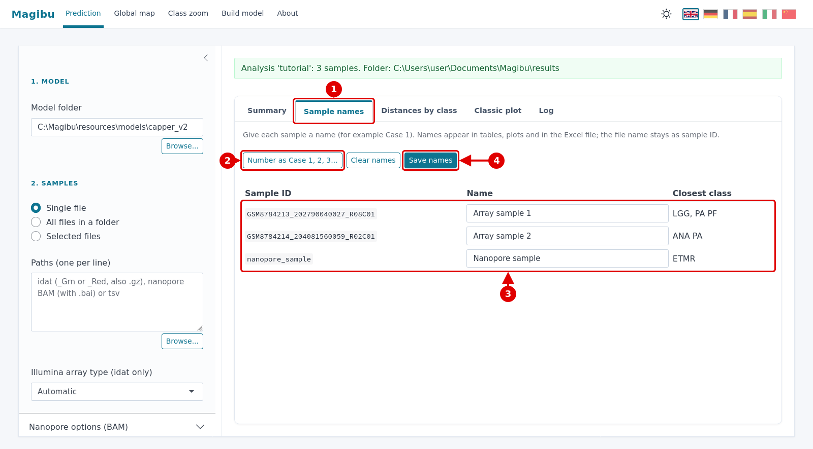

1. Click **Sample names**.
2. **Number as Case 1, 2, 3...** fills in the names automatically.
3. Or type a name for each sample.
4. Click **Save names**. The names are then used in all tables, plots, the Excel file and the PDF. The files on
   disk keep their original names.

### Distances by class

All the classes of the model for one sample, from the closest to the farthest.

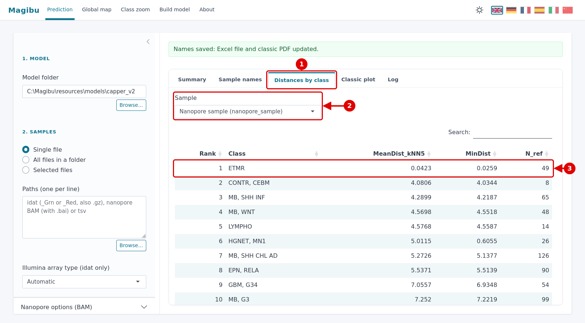

1. Click **Distances by class**.
2. Choose the **Sample**.
3. The first row is the closest class.
   - **MeanDist_kNN5**: the average distance from the 5 closest samples of that class (smaller = closer).
   - **MinDist**: the distance from the closest sample of that class.
   - **N_ref**: how many reference samples the class has.

A big difference between the first and the second row means a clear result: here 0.04 for ETMR against 4.08 for the
next class. Similar values mean the sample lies between classes.

### Classic plot

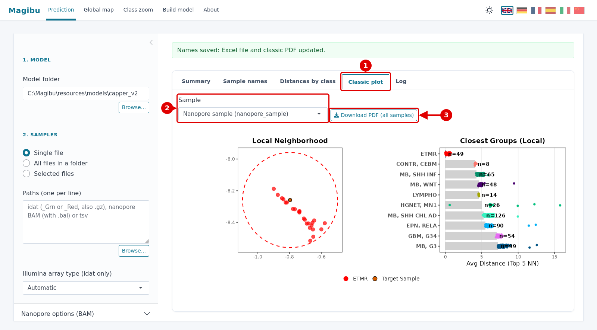

1. Click **Classic plot**.
2. Choose the **Sample**.
3. **Download PDF (all samples)**: one PDF with the plots of all samples.

Reading the plot:
- **Left (Local Neighborhood):** your sample (dark dot) among the closest reference samples, coloured by class.
- **Right (Closest Groups):** the closest classes. The grey bar is the average distance from the 5 closest samples
  of each class (shorter = closer); `n` is the number of samples in the class.

---

## 3. Explore the global map

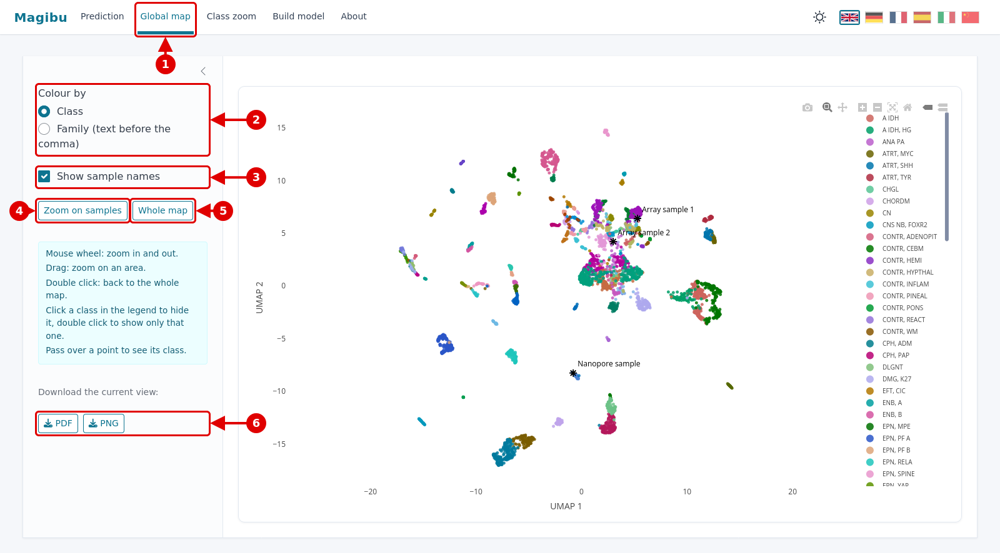

1. Click **Global map** in the top bar. The whole reference model is shown, with your samples as black stars.
2. **Colour by**: by class, or by family (for example all the `MB, ...` classes in one colour).
3. **Show sample names**: shows or hides the names of your samples.
4. **Zoom on samples**: moves the view to your samples.
5. **Whole map**: back to the full map.
6. **PDF** / **PNG**: save what you see.

On the map:
- the mouse wheel zooms in and out;
- dragging zooms on an area;
- a double click goes back to the whole map;
- passing over a point shows its class.

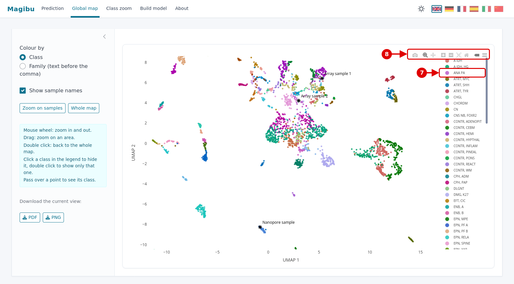

7. **Legend**: click a class to hide it, double click to show only that class. Double click again to show all.
8. **Toolbar** (appears when the mouse is over the map): zoom, move, reset the view and save a picture.

---

## 4. Build your own model

A model is a reference map built from samples whose class you already know. To build one you need:
- **a folder** with the samples: idat files (EPIC v2, EPIC v1 or 450k);
- **a table** (tsv or csv, for example saved from Excel), with one row per sample, one column with the sample name and
  one with its class.

  The sample name is the file name without `_Grn.idat` / `_Red.idat`. Example:

  | sample | class |
  |---|---|
  | GSM2402860_5911815001_R04C01 | MB, WNT |
  | GSM2402862_5911815001_R02C01 | ETMR |

  A class written with a comma, like `MB, WNT`, is read as *family, subclass*. This is used by the family colouring.

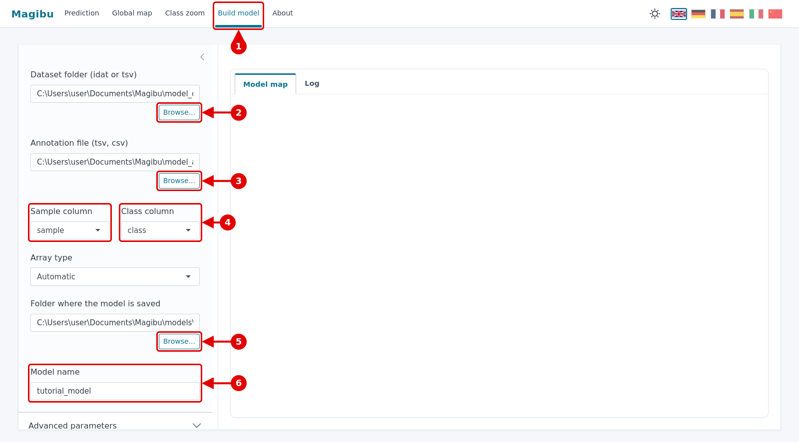

1. Click **Build model** in the top bar.
2. **Browse...** under *Dataset folder*: the folder with the samples.
3. **Browse...** under *Annotation file*: the table.
4. **Sample column** and **Class column**: choose which column of the table has the sample names and which has the
   classes.
5. **Browse...** under *Folder where the model is saved*: choose a **new, empty folder**, one for each model. Its
   name becomes the title of the model.
6. **Model name**: the name of the model files.

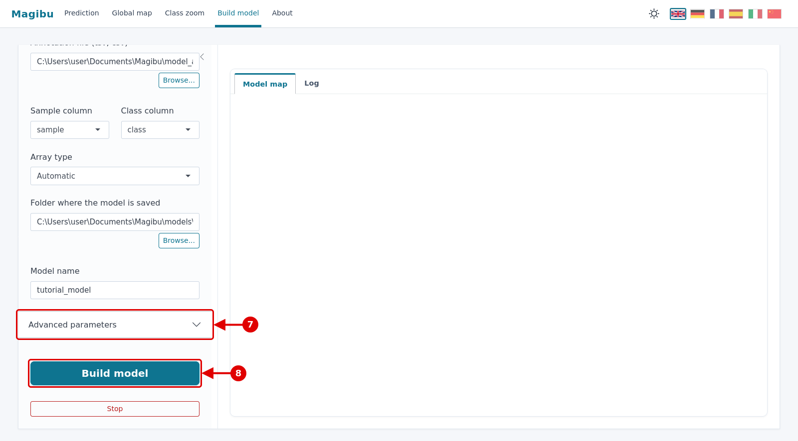

7. **Advanced parameters**: the default values are fine in most cases.
8. Click **Build model**. With about a hundred samples it takes about a minute; with thousands of samples it takes
   longer.

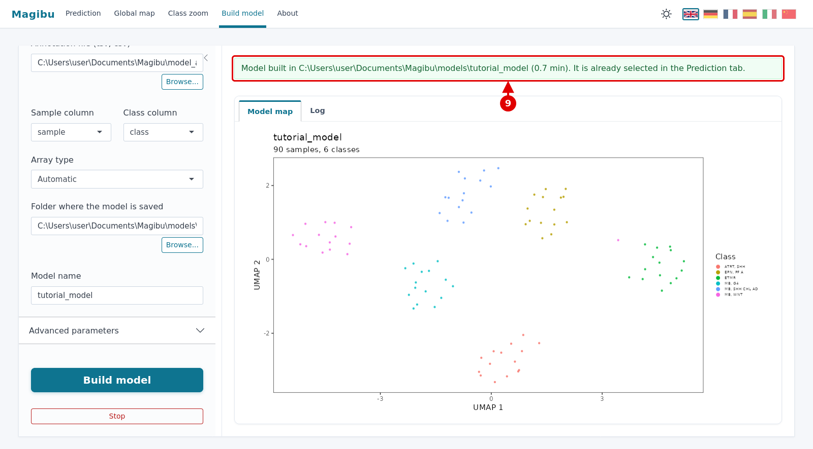

9. When it ends, the green bar confirms where the model was saved and the map of the model appears. Each colour is a
   class.

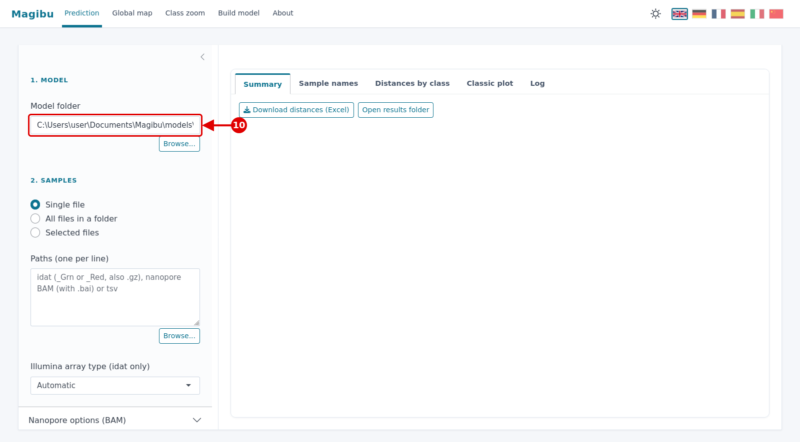

10. The new model is already selected in **Prediction**. You can now classify samples against it as in
    [section 1](#1-classify-samples). Next time, select its folder with **Browse...** under *Model folder*.

---

## If something goes wrong

| Message | What to do |
|---|---|
| *BAM index (.bai) not found* | the `.bai` file must be in the same folder as the `.bam`, with the same name |
| Yellow warning *Few model CpGs measured* | too few CpG sites were read (for example a very short sequencing run): the result is not reliable |
| *Unrecognised file* | select `_Grn.idat` / `_Red.idat` files for arrays, `.bam` files for nanopore |
| *The destination folder already contains a model* | in *Build model*, choose a new empty folder |
| The same sample lands in slightly different points in two runs | normal: the map projection has a small random component. The closest classes of a clearly placed sample do not change |
